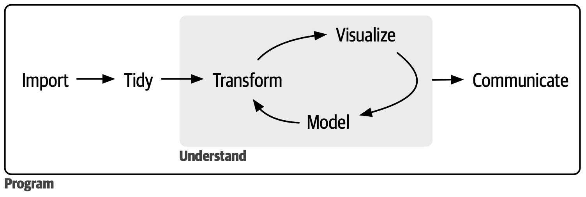
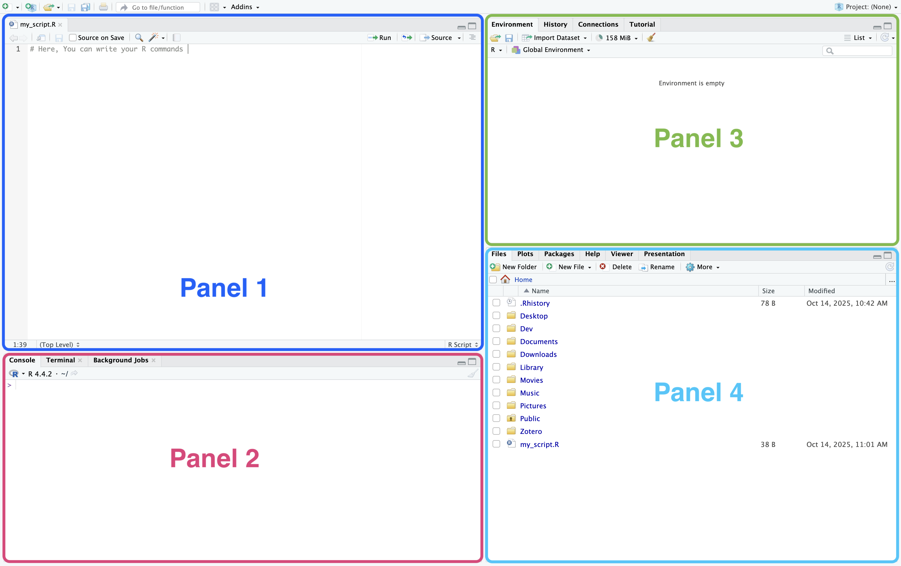

# Why statistics? {background="#9B0014"}

## From a sample to general conclusions {style="font-size: 0.6em;"}

We observe a **tiny portion** of the world, e.g. a few subjects, sessions, trials.

We want conclusions that hold **in general**.

. . .

Statistics quantifies how much we can generalise **despite**

- measurement noise (instruments, questionnaires);
- variability between and within subjects;
- factors we did not measure.

## Fisher's three ideas, in neuroscience {style="font-size: 0.6em;"}

**Study of populations**

- 100 subjects scanned once: population *across individuals*.
- 1 subject scanned daily for a year: population *across time*.

. . .

**Study of variation**

- Variability between subjects, across time, across space.

. . .

**Data reduction**

- From millions of numbers per subject to summaries (means, components, features).

[Fisher (1925), *Statistical Methods for Research Workers*, ch. 1](https://psychclassics.yorku.ca/Fisher/Methods/chap1.htm)

## A warning we will carry along {style="font-size: 0.6em;"}

Classical tools (t-test, ANOVA, regression) assume **independent observations**.

. . .

Neuroscience data often are not:

- 10 trials from one subject are more *similar* than 10 trials from 10 subjects;
- the same questionnaire filled in 6 times by one participant gives correlated scores.

. . .

Ignoring this leads to **overconfidence** (underestimation of uncertainty)

A standard tool to deal with correlated responses is *mixed models*, but they we will not cover them in this course. 

## The reproducibility crisis {style="font-size: 0.6em;"}

- **Reproducibility**: same data and same analysis give the same results.
- **Replication**: new data on the same question give consistent results.

. . .

- *Nature* survey of 1,576 researchers: more than 70% had tried and failed to replicate another scientist's experiments, more than half their own ([Baker, 2016](https://doi.org/10.1038/533452a)).
- 70 teams analysed the same brain-imaging data to test the same 9 hypotheses. No two teams used the same workflow, and their results varied considerably ([Botvinik-Nezer et al., 2020](https://doi.org/10.1038/s41586-020-2314-9)).

. . .

Common threats: low statistical power, trying analyses until something is significant (p-hacking), hypotheses made up after seeing the results, unpublished null results, no shared data or code ([Munafò et al., 2017](https://doi.org/10.1038/s41562-016-0021)).

## A starting point {style="font-size: 0.6em;"}

- State the hypothesis **before** looking at the data.
- Share **raw data** and **code**. Every number in the paper generated automatically.
- Write reports where text, code and results live **together**.

. . .

::: {.r-fit-text}
This is why we analyse data with code.
:::

## The data analysis pipeline {style="font-size: 0.6em;"}

{width=90% fig-align="center"}


Figure from Wickham, Çetinkaya-Rundel and Grolemund, [*R for Data Science*](https://r4ds.hadley.nz/intro), 2nd ed.

# Introduction to R {background="#9B0014"}

## RStudio {style="font-size: 0.6em;"}

{width=70% fig-align="center"}

## Basic R grammar {style="font-size: 0.6em;"}

Run a line: `Ctrl+Enter` (Windows) / `Cmd+Enter` (Mac).

```{r}
#| echo: TRUE
a <- 1                    # assign 1 to a (numeric value)
b <- 2
label <- "control"        # character value
a + b
```

. . .

Vectors:

```{r}
#| echo: TRUE
rt <- c(512, 430, 601, 488, 550)  # reaction times (ms)
trials <- 1:5                     # sequence 1 to 5
seq(0, 1, by = 0.25)              # regular sequence
```

## Working with vectors {style="font-size: 0.6em;"}

```{r}
#| echo: TRUE
rt[1]            # first element
rt[2:4]          # elements 2 to 4
rt[c(1, 5)]      # elements 1 and 5
```

. . .

Operations are **element-wise**:

```{r}
#| echo: TRUE
rt / 1000        # convert to seconds
rt - mean(rt)    # centre around the mean
```

. . .

```{r}
#| echo: TRUE
mean(rt); sd(rt); length(rt); range(rt)
```

## RStudio tips and help {style="font-size: 0.6em;"}

- **Tab**: autocomplete names.
- **`Alt + -`** / **`Option + -`**: insert `<-`.
- **Environment** pane: the objects you created.
- Write code in a **file**, not the console.

. . .

```{r}
#| echo: TRUE
#| eval: FALSE
?mean
```

Read **Arguments** and **Examples**. E.g. to ignore `NA`s in `mean()`, use `na.rm = TRUE`.

## Missing values {style="font-size: 0.6em;"}

No response on a trial: `NA`.

```{r}
#| echo: TRUE
rt <- c(512, 430, NA, 488, 550)
mean(rt)
mean(rt, na.rm = TRUE)
```

. . .

```{r}
#| echo: TRUE
is.na(rt)
sum(is.na(rt))
which(is.na(rt))
```

## Common mistakes {style="font-size: 0.6em;"}

R is case-sensitive: `RT` and `rt` are different objects. Pick one style (`snake_case`: `mean_rt`).

. . .

```{r}
#| echo: TRUE
#| eval: FALSE
mean(c(1, 2, 3)
```
Missing `)`: R shows `+` and waits. Press **Esc**.

. . .

```{r}
#| echo: TRUE
#| eval: FALSE
maen(rt)
```
`Error in maen(rt) : could not find function "maen"`

. . .

```{r}
#| echo: TRUE
#| eval: FALSE
RT
```
`Error: object 'RT' not found`

## Logical values and comparisons {style="font-size: 0.6em;"}

| Operator | Meaning | Example |
|----------|---------|---------|
| `==`, `!=` | equal, not equal | `3 == 3` is `TRUE` |
| `<`, `>`, `<=`, `>=` | comparisons | `5 > 2` is `TRUE` |
| `%in%` | element in a set | `"a" %in% c("a","b")` is `TRUE` |
| `&`, `|`, `!` | and, or, not | `TRUE & FALSE` is `FALSE` |

. . .

```{r}
#| echo: TRUE
rt <- c(512, 430, 1601, 488, 150)
too_fast_or_slow <- rt < 200 | rt > 1500   # flag implausible trials
rt[!too_fast_or_slow]                       # keep valid trials
```

## Factors {style="font-size: 0.6em;"}

Categorical variables with fixed **levels**:

```{r}
#| echo: TRUE
group <- factor(c("patient", "control", "control", "patient", "control"))
levels(group)
table(group)
```

. . .

Ordered categories (a Likert item):

```{r}
#| echo: TRUE
answer <- c("never", "always", "often", "never")
factor(answer, levels = c("never", "often", "always"), ordered = TRUE)
```

## Data frames {style="font-size: 0.6em;"}

One row per observation, one column per variable. Columns can have different types.

```{r}
#| echo: TRUE
#| code-line-numbers: "1|2-5|7"
subjects <- data.frame(
  id    = c("S01", "S02", "S03", "S04"),
  group = factor(c("patient", "control", "patient", "control")),
  age   = c(64, 58, 71, 60),
  score = c(22, 29, 19, 28)
)
subjects
```

## Data frames: access {style="font-size: 0.6em;"}

```{r}
#| echo: TRUE
dim(subjects)
str(subjects)
```

. . .

```{r}
#| echo: TRUE
subjects$age                                       # a column
subjects[2, ]                                      # a row
subjects[subjects$age > 60 & subjects$score < 24, ] # rows: over 60 and score below 24
```

## Functions {style="font-size: 0.6em;"}

```{r}
#| echo: TRUE
#| eval: FALSE
name <- function(arg1, arg2 = default) {
  # body
  result          # last value is returned
}
```

. . .

The standard error of the mean, $s / \sqrt{n}$:

```{r}
#| echo: TRUE
se <- function(x) {
  sd(x) / sqrt(length(x))
}
se(c(512, 430, 601, 488, 550))
```

## Packages {style="font-size: 0.6em;"}

```{r}
#| echo: TRUE
#| eval: FALSE
install.packages("tidyverse")   # once, in the console
library(tidyverse)              # at the top of every file that uses it
here::here("data")              # package::function(): one function, no library()
```

. . .

End every report with `sessionInfo()`: R and package versions.

# Reports with Quarto {background="#9B0014"}

## Why reports from code? {style="font-size: 0.6em;"}

The copy-paste workflow:

1. run the script;
2. copy numbers into Word, paste plots;
3. a reviewer asks to exclude 3 subjects... redo it all by hand.

. . .

A **Quarto** document (`.qmd`) holds **text**, **code** and (after rendering) **results**:

- every number is computed when the document is created;
- new data? Click **Render** and everything updates.

## Anatomy of a `.qmd` file {style="font-size: 0.55em;"}

````markdown
---
title: "Sleep deprivation: first look"
author: "Your Name"
format: html
---

## Data

```{{r}}
#| echo: false
sleepstudy <- read.csv(here::here("data", "sleepstudy.csv"))
```

The dataset contains `{{r}} nrow(sleepstudy)` measurements.
````

1. **YAML header** between `---`: title, author, format (`html`, `pdf`, `docx`).
2. **Markdown** text: `## Section`, `**bold**`, `*italic*`, `- lists`, `$\bar x$`.
3. **Code chunks**: run at render; options start with `#|`.
4. **Inline code**: numbers inside sentences, never typed by hand.

## Rendering and chunk options {style="font-size: 0.6em;"}

**Render**: `Ctrl/Cmd + Shift + K`. The file runs **from scratch**: it must load its own packages and data.

. . .

| Option | Effect |
|---|---|
| `#| echo: false` | hide code, show results |
| `#| eval: false` | show code, don't run it |
| `#| include: false` | run, show nothing |
| `#| label: fig-rt` and `#| fig-cap: "..."` | numbered figure, cite with `@fig-rt` |


# Hands-on {background="#9B0014"}

## Practice

- Connect to [https://giuseppealfonzetti.github.io/s4ns-A/](https://giuseppealfonzetti.github.io/s4ns-A/)

- Click on the ["Exercises" link](exercises.qmd) corresponding to today class.