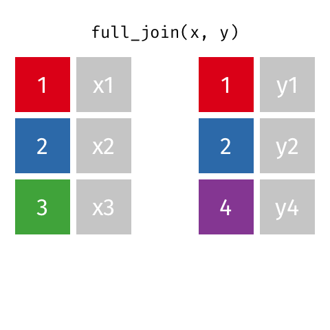
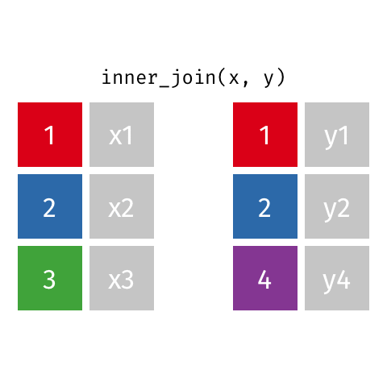
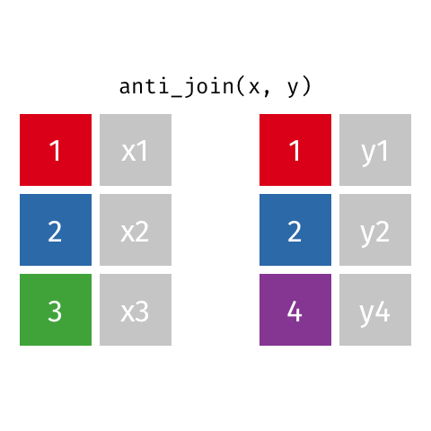

```{r load}
options(width = 70)
library(tidyverse)
library(here)
penguins <- as_tibble(penguins)
options(pillar.print_min = 5, pillar.print_max = 5)
```

## Today {style="font-size: 0.8em;"}

1. Functions to manipulate a data frame;
2. Summaries **by group**;
4. Import and clean;
5. Combining tables, **wide** and **long** format.

# The tidyverse {background="#9B0014"}

## Packages {style="font-size: 0.8em;"}

The `tidyverse` is a set of packages that share one style. Install it once, load it in every file:

```{r}
#| echo: TRUE
#| eval: FALSE
install.packages("tidyverse")   # once, in the console
library(tidyverse)              # at the top of every document
```

. . .

Tidy data:

- each **row** is an observation;
- each **column** is a variable;
- each **cell** is a single value.

## Our example: `penguins` {style="font-size: 0.8em;"}

Built into R (version 4.5 or later): 344 penguins, 3 species, 3 islands.

```{r}
#| echo: TRUE
penguins
```

A **tibble** is a data frame that prints more nicely: size, column types, first rows.

## `select()` columns {style="font-size: 0.8em;"}

```{r}
#| echo: TRUE
select(penguins, species, sex, body_mass)
```

In session 1: `penguins[, c("species", "sex", "body_mass")]`.

## `filter()` rows {style="font-size: 0.8em;"}

```{r}
#| echo: TRUE
filter(penguins, sex == "female", island == "Biscoe")
```

A comma means **and**. In session 1: `penguins[penguins$sex == "female" & penguins$island == "Biscoe", ]`.

## `mutate()` {style="font-size: 0.8em;"}

`mutate()` adds or changes a column:

```{r}
#| echo: TRUE
mutate(penguins, body_mass_kg = body_mass / 1000)
```

## `arrange()` {style="font-size: 0.8em;"}

`arrange()` sorts the rows, `desc()` from largest to smallest:

```{r}
#| echo: TRUE
arrange(penguins, desc(body_mass))
```

## The pipe `|>` {style="font-size: 0.8em;"}

Read `|>` as **"and then"**. Shortcut: `Ctrl/Cmd + Shift + M`.

```{r}
#| echo: TRUE
#| code-line-numbers: "1|2|3|4|5"
penguins |>
  filter(sex == "female") |>
  select(species, body_mass) |>
  mutate(body_mass_kg = body_mass / 1000) |>
  arrange(body_mass_kg)
```

`x |> f()` is the same as `f(x)`. Older code uses `%>%`: same thing.

## Summaries by group {style="font-size: 0.8em;"}

In session 1 we computed a mean for each group, one group at a time. `group_by()` and `summarise()` do all groups at once:

```{r}
#| echo: TRUE
penguins |>
  group_by(species) |>
  summarise(
    n         = n(),
    mean_mass = mean(body_mass, na.rm = TRUE),
    sd_mass   = sd(body_mass, na.rm = TRUE)
  )
```

## Counting rows {style="font-size: 0.8em;"}

How many rows per group: `count()`.

```{r}
#| echo: TRUE
count(penguins, species, island)
```

## Describing a numeric variable: centre {style="font-size: 0.8em;"}

| Summary | What it says | R |
|---|---------|------|
| mean | the average: the sum divided by $n$ | `mean(x)` |
| median | the middle value: half below, half above | `median(x)` |
| percentile | the 25th percentile has 25% of the values below it | `quantile(x, 0.25)` |

- The median is the 50th percentile. The 25th and 75th are the **quartiles**.
- Missing values? Add `na.rm = TRUE`, as before.

## Describing a numeric variable: spread {style="font-size: 0.8em;"}

| Summary | What it says | R |
|---|---------|------|
| range | from the smallest to the largest value | `min(x)`, `max(x)` |
| middle half | from the 25th to the 75th percentile | `quantile(x, c(0.25, 0.75))` |
| variance | the average squared distance from the mean | `var(x)` |
| standard deviation | the square root of the variance, in the units of the data | `sd(x)` |

The more the values differ from each other, the larger all four.

## Seeing them {style="font-size: 0.8em;"}

```{r}
#| fig-height: 4.6
m <- penguins$body_mass[!is.na(penguins$body_mass)]
bars <- tibble(
  what = c("range: min to max",
           "middle half: 25th to 75th percentile",
           "mean minus 1 sd to mean plus 1 sd"),
  from = c(min(m), quantile(m, 0.25), mean(m) - sd(m)),
  to   = c(max(m), quantile(m, 0.75), mean(m) + sd(m)),
  y    = c(-5, -11, -17)
)
ggplot(tibble(m), aes(x = m)) +
  geom_histogram(binwidth = 100, fill = "grey75", colour = "white") +
  annotate("segment", x = mean(m), xend = mean(m), y = 0, yend = 25,
           colour = "#9B0014", linewidth = 1) +
  annotate("segment", x = median(m), xend = median(m), y = 0, yend = 25,
           colour = "#1565C0", linewidth = 1, linetype = 2) +
  annotate("text", x = mean(m), y = 27, label = "mean", colour = "#9B0014",
           hjust = -0.1, size = 5) +
  annotate("text", x = median(m), y = 27, label = "median", colour = "#1565C0",
           hjust = 1.1, size = 5) +
  geom_segment(data = bars, aes(x = from, xend = to, y = y, yend = y), linewidth = 2) +
  geom_text(data = bars, aes(x = (from + to) / 2, y = y + 2.5, label = what), size = 4.5) +
  labs(x = "Body mass (g)", y = "Number of penguins") +
  theme_minimal(base_size = 16)
```

Body mass is **right-skewed**: a tail of heavy penguins pulls the mean above the median.

## Summaries by group, all together {style="font-size: 0.8em;"}

```{r}
#| echo: TRUE
penguins |>
  group_by(species) |>
  summarise(
    mean   = mean(body_mass, na.rm = TRUE),
    median = median(body_mass, na.rm = TRUE),
    p25    = quantile(body_mass, 0.25, na.rm = TRUE),
    p75    = quantile(body_mass, 0.75, na.rm = TRUE),
    min    = min(body_mass, na.rm = TRUE),
    max    = max(body_mass, na.rm = TRUE),
    sd     = sd(body_mass, na.rm = TRUE)
  )
```

The variance is `sd^2`: in squared grams, hard to read. Report the sd.

# Import {background="#9B0014"}

## Work inside an R Project {style="font-size: 0.8em;"}

Before reading any data, organise your work in an **RStudio Project**: a folder that contains your scripts *and* your data.

- `File > New Project...` in RStudio creates the project folder.
- Move your data files inside that folder, for example in `data/`.

. . .

The `here` package builds file paths **from the project folder**: no `C:/Users/...` paths, no `setwd()`. The same code runs on any computer.

```{r}
#| echo: TRUE
#| eval: FALSE
library(here)
here("data", "questionnaire.xlsx")   # <project>/data/questionnaire.xlsx
```

## Reading Excel files: `read_xlsx()` {style="font-size: 0.8em;"}

Excel files (`.xls`, `.xlsx`) need the `readxl` package:

```{r}
#| echo: TRUE
#| eval: FALSE
library(readxl)
answers <- read_xlsx(here("data", "questionnaire.xlsx"))
```

. . .

An Excel file can contain **several sheets**. Pick one with the `sheet` argument:

```{r}
#| echo: TRUE
#| eval: FALSE
answers <- read_xlsx(here("data", "questionnaire.xlsx"), sheet = "day_1")
```

For `.csv` files: `read_csv()`, from the tidyverse.

## Save your results {style="font-size: 0.8em;"}

Use `here()` to write files into your project too. Take a result like:

```{r}
#| echo: TRUE
my_res <- penguins |>
  group_by(species) |>
  summarise(mean_bill = mean(bill_len, na.rm = TRUE))
my_res
```

## Save to a file {style="font-size: 0.8em;"}

**As an R file**, to use again in R:

```{r}
#| echo: TRUE
#| eval: FALSE
write_rds(my_res, here("my_results.rds"))   # save
my_res <- read_rds(here("my_results.rds"))  # load next time
```

**As an Excel file:**

```{r}
#| echo: TRUE
#| eval: FALSE
library(writexl)
write_xlsx(my_res, here("my_results.xlsx"))
```

# Cleaning {background="#9B0014"}

## Inconsistent column names {style="font-size: 0.8em;"}

Real files rarely have tidy names: spaces, random capitals, dots...

```{r}
#| echo: TRUE
raw <- data.frame(`Participant ID` = c("P01", "P02"),
                  `Age (years)` = c(23, 31),
                  `Reaction.Time` = c(512, 430),
                  check.names = FALSE)  # keep the messy names
raw
```

. . .

`clean_names()` from the `janitor` package makes them all lower case, with `_` between words:

```{r}
#| echo: TRUE
library(janitor)
clean_names(raw)
```

## Missing values {style="font-size: 0.8em;"}

Missing entries are stored as `NA`:

```{r}
my_df <- data.frame(
  id = 1:5,
  group = c("control", "exercise", "control", "exercise", "control"),
  sleep_hours = c(7, 6.5, NA, 8, 5.5),
  mood = c(6, NA, 7, 8, 4))
```

```{r}
#| echo: TRUE
my_df
```

. . .

**Find** them with `is.na()`:

```{r}
#| echo: TRUE
is.na(my_df$sleep_hours)
```

Any operation involving `NA` returns `NA`: pass `na.rm = TRUE` to summaries such as `mean()`.

# Working with multiple data frames {background="#9B0014"}

## Case study {style="font-size: 0.8em;"}

```{r}
options(pillar.print_min = 10, pillar.print_max = 10)
professions <- read_csv(here("assets", "session2", "professions.csv"))
dates <- read_csv(here("assets", "session2", "dates.csv"))
works <- read_csv(here("assets", "session2", "works.csv"))
```

Information about 10 women in science who changed the world, spread across **three** datasets:

```{r}
#| echo: TRUE
professions |> select(name)
```

## Information spread across three datasets {style="font-size: 0.8em;"}

::: {.panel-tabset}

### Professions
```{r}
#| echo: TRUE
professions
```

### Dates
```{r}
#| echo: TRUE
dates
```

### Works
```{r}
#| echo: TRUE
works
```

:::

## Desired output {style="font-size: 0.8em;"}

```{r}
professions |>
  left_join(dates) |>
  left_join(works)
```

## Joining data frames {style="font-size: 0.8em;"}

- `left_join()`: all rows from x
- `right_join()`: all rows from y
- `full_join()`: all rows from both x and y
- `inner_join()`: only rows with a match in both
- `semi_join()`: rows from x with a match in y, keeping only x's columns
- `anti_join()`: rows from x with **no** match in y

Animations on the next slides: [tidyexplain](https://github.com/gadenbuie/tidyexplain), by Garrick Aden-Buie.

## Example {style="font-size: 0.8em;"}

::: {.columns}
::: {.column width="50%"}

```{r}
x <- data.frame(
  id = c(1, 2, 3),
  value_x = c("x1", "x2", "x3")
)
```

```{r}
#| echo: TRUE
x
```
:::
::: {.column width="50%"}

```{r}
y <- data.frame(
  id = c(1, 2, 4),
  value_y = c("y1", "y2", "y4")
)
```

```{r}
#| echo: TRUE
y
```
:::
:::

## `left_join()` {style="font-size: 0.8em;"}

::: {.columns}
::: {.column width="50%"}

:::
::: {.column width="40%"}

```{r}
#| echo: TRUE
x |>
  left_join(y)
```

:::
:::

## `right_join()` {style="font-size: 0.8em;"}

::: {.columns}
::: {.column width="50%"}

:::
::: {.column width="40%"}

```{r}
#| echo: TRUE
x |>
  right_join(y)
```

:::
:::

## `full_join()` {style="font-size: 0.8em;"}

::: {.columns}
::: {.column width="50%"}

:::
::: {.column width="40%"}

```{r}
#| echo: TRUE
x |>
  full_join(y)
```

:::
:::

## `inner_join()` {style="font-size: 0.8em;"}

::: {.columns}
::: {.column width="50%"}

:::
::: {.column width="40%"}

```{r}
#| echo: TRUE
x |>
  inner_join(y)
```

:::
:::

## `semi_join()` {style="font-size: 0.8em;"}

::: {.columns}
::: {.column width="50%"}

:::
::: {.column width="40%"}

```{r}
#| echo: TRUE
x |>
  semi_join(y)
```

:::
:::

## `anti_join()` {style="font-size: 0.8em;"}

::: {.columns}
::: {.column width="50%"}

:::
::: {.column width="40%"}

```{r}
#| echo: TRUE
x |>
  anti_join(y)
```

:::
:::

## Back to the data {style="font-size: 0.8em;"}

```{r}
#| echo: TRUE
professions |>
  left_join(dates) |>  # join by name
  left_join(works)     # join by name
```

# Pivoting {background="#9B0014"}

```{r}
moods <- tibble(
  id = c(1, 2),
  day_1 = c(6, 4),
  day_2 = c(7, 5),
  day_3 = c(8, NA)
)
groups <- tibble(
  id = c(1, 2, 3),
  group = c("exercise", "control", "exercise")
)
```

## Case study {style="font-size: 0.8em;"}

Two people rated their mood from 1 to 10 on three days. Person 2 skipped day 3. A second table says which group each person was in.

::: {.columns}
::: {.column width="50%"}

```{r}
#| echo: TRUE
moods
```

:::
::: {.column width="40%"}

```{r}
#| echo: TRUE
groups
```
:::
:::

## Desired output {style="font-size: 0.8em;"}

One row per person and day, with the group:

```{r}
moods |>
  pivot_longer(cols = day_1:day_3, names_to = "day", values_to = "mood") |>
  left_join(groups)
```

## From wide to long: `pivot_longer()` {style="font-size: 0.8em;"}

```{r}
moods
```

```{r}
#| echo: TRUE
#| code-line-numbers: "2,6|3|4|5"
ratings <- moods |>
  pivot_longer(
    cols = c(day_1, day_2, day_3),  # columns to pivot
    names_to = "day",               # their names go to day
    values_to = "mood"              # their values go to mood
  )
ratings
```

## From long to wide: `pivot_wider()` {style="font-size: 0.8em;"}

Going back from ratings to moods:

```{r}
#| echo: TRUE
#| code-line-numbers: "1|2,5|3|4"
ratings |>
  pivot_wider(
    names_from = "day",    # column names
    values_from = "mood"   # values in columns
  )
```

## Putting it together {style="font-size: 0.8em;"}

```{r}
#| echo: TRUE
ratings |>
  left_join(groups)
```

Person 3 has no ratings, so `left_join()` leaves them out.

## Summary: one table {style="font-size: 0.8em;"}

| Task | Function |
|---|---|
| keep columns (and rename them) | `select()` |
| keep rows | `filter()` |
| add or change a column | `mutate()` |
| sort rows | `arrange()` |
| summary per group | `group_by()` and `summarise()`, `count()` |
| centre and spread | `mean()`, `median()`, `quantile()`, `min()`, `max()`, `var()`, `sd()` |

## Summary: files and cleaning {style="font-size: 0.8em;"}

| Task | Function |
|---|---|
| paths from the project folder | `here()` |
| read a file | `read_csv()`, `read_xlsx()` |
| save a result | `write_rds()`, `write_xlsx()` |
| tidy column names | `clean_names()` |
| find missing values | `is.na()` |

## Summary: combining and reshaping {style="font-size: 0.8em;"}

| Task | Function |
|---|---|
| combine two tables | `left_join()`, `right_join()`, `full_join()`, `inner_join()` |
| keep or drop rows by a match | `semi_join()`, `anti_join()` |
| reshape | `pivot_longer()`, `pivot_wider()` |

Cheatsheets: [dplyr](https://rstudio.github.io/cheatsheets/data-transformation.pdf), [tidyr](https://rstudio.github.io/cheatsheets/tidyr.pdf).

# Hands-on {background="#9B0014"}

## Practice

- Connect to [https://giuseppealfonzetti.github.io/s4ns-A/](https://giuseppealfonzetti.github.io/s4ns-A/)
- Click on the "Exercises" link for today's class.
